  <picture><source media="(prefers-color-scheme: dark)" srcset="assets/header-dark.svg"></picture>

  <a href="https://project-portfolio-nine-flax.vercel.app"><b>Portfolio</b></a>&nbsp;&nbsp;·&nbsp;&nbsp;<a href="https://linkedin.com/in/talalaamir"><b>LinkedIn</b></a>&nbsp;&nbsp;·&nbsp;&nbsp;<a href="https://www.tiktok.com/@intellectuelathlete"><b>TikTok</b></a>&nbsp;&nbsp;·&nbsp;&nbsp;<a href="mailto:talalaamir958@gmail.com"><b>Email</b></a>

 

### About

- Computer science engineering student at **CY Tech, Paris**.
- **AI engineer apprentice at Safran Aircraft Engines**: I design and ship agentic AI that automates sales administration.
- I build products end to end, from the model to the interface, and I love hackathons.

 

  <picture><source media="(prefers-color-scheme: dark)" srcset="assets/highlights-dark.svg"></picture>

 

### Featured projects

  <a href="https://github.com/talal95c/LawHack"><picture><source media="(prefers-color-scheme: dark)" srcset="assets/project-legible-dark.svg"></picture></a>
  <a href="https://adib.wiki"><picture><source media="(prefers-color-scheme: dark)" srcset="assets/project-adib-dark.svg"></picture></a>

  <a href="https://github.com/talal95c/Sylo.ai-"><picture><source media="(prefers-color-scheme: dark)" srcset="assets/project-sylo-dark.svg"></picture></a>
  <a href="https://project-portfolio-nine-flax.vercel.app/work/miropolis"><picture><source media="(prefers-color-scheme: dark)" srcset="assets/project-miropolis-dark.svg"></picture></a>

<b>More projects</b>

 

| Project | What it is |
| --- | --- |
| [Dino Race Fight Club](https://github.com/talal95c/hackathon-Google-x-vodoo-) | 3D browser racing game with a live AI soundtrack, built at the Google × Voodoo hackathon |
| [Deep-ML](https://github.com/talal95c/deep-ml) | Machine learning problems from Deep-ML, every solution written by hand |
| [C-Wildwater](https://github.com/talal95c/Projet-Info-S3-MI1-) | C and Shell pipeline over 2M+ lines of water-network data, under strict memory limits |
| [Chess engine](https://github.com/talal95c/chess_engine-) | Chess engine in Python |
| [Portfolio](https://github.com/talal95c/Portfolio-) | My website, in SvelteKit and Three.js |

 

### Stack

  <picture>
    <source media="(prefers-color-scheme: dark)" srcset="https://skillicons.dev/icons?i=py%2Cts%2Cc%2Creact%2Cnextjs%2Csvelte%2Ctailwind%2Cfastapi%2Csupabase%2Cthreejs%2Csolidity%2Cpytorch%2Cdocker%2Cgit%2Cvercel&perline=15&theme=dark">
    
  </picture>

 

### Activity

  <picture><source media="(prefers-color-scheme: dark)" srcset="assets/activity-dark.svg"></picture>

Cards are animated SVGs regenerated every day by <a href=".github/workflows/update.yml">a GitHub Action</a>.

