  <picture><source media="(prefers-color-scheme: dark)" srcset="assets/terminal-dark.svg"></picture>

  <a href="https://project-portfolio-nine-flax.vercel.app"><b>Portfolio</b></a>&nbsp;&nbsp;·&nbsp;&nbsp;<a href="https://linkedin.com/in/talalaamir"><b>LinkedIn</b></a>&nbsp;&nbsp;·&nbsp;&nbsp;<a href="mailto:talalaamir958@gmail.com"><b>Email</b></a>

### Projects

- **[Adib](https://adib.wiki)**: Arabic and Quran vocabulary app for web and iOS, built on spaced repetition.
- **[Legible](https://github.com/talal95c/LawHack)**: tells who said what in French court rulings, then answers with cited paragraphs.
- **[Deep-ML](https://github.com/talal95c/deep-ml)**: machine learning problems solved from scratch, by hand.
- **[Chess engine](https://github.com/talal95c/chess_engine-)**: a playable chess engine in Python.

### Activity

<picture><source media="(prefers-color-scheme: dark)" srcset="assets/activity-dark.svg"></picture>

Refreshed every 6 hours by <a href=".github/workflows/update.yml">a GitHub Action</a>.

